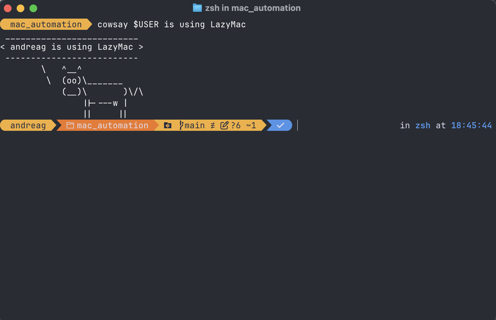

# Lazy Mac

Life is too short to spend time installing tools.

## Getting Started

This project transforms a brand-new MacBook into a full-fledged developer workstation with useful tools and sensible defaults, so you don't need to do a tedious setup on your own.

At the end of the execution you will find the following tools installed and configured on your MacBook:

- **Core & Shell:** Xcode Command Line Tools, Homebrew, Ghostty, Oh My Posh, Visual Studio Code, Git, Tmux, SSH Keychain integration
- **Containers & VMs:** Podman, Podman Desktop, Lima, QEMU
- **Developer Tools:** IntelliJ IDEA CE, Chruby, jEnv, JFrog CLI
- **Cloud & DevOps:** AWS CLI, Granted, Kubectx, K9s, Helm, TFSwitch, TGSwitch, OpenTofu, TFLint, Checkov, Terragrunt, Packer
- **AI Coding Harness:** Codex, Antigravity CLI, Claude Code, OpenCode



## How to Use It

### Quick One-Liner (Fresh Mac)

Run the bootstrap script directly—it automatically downloads the repository to a temporary workspace, runs the setup, and cleans up after itself:

```zsh
/bin/bash -c "$(curl -fsSL https://raw.githubusercontent.com/threeturn/LazyMac/main/bootstrap.sh)"
```

You can also pass flags directly to the one-liner:

```zsh
/bin/bash -c "$(curl -fsSL https://raw.githubusercontent.com/threeturn/LazyMac/main/bootstrap.sh)" -- --persona devops --verify
```

### Clone & Customize Workflow

If you want to customize cookbook attributes or re-run the configuration over time:

```zsh
git clone https://github.com/threeturn/LazyMac.git
cd LazyMac

# Optional: customize attributes for your machine
cp attributes.example.yml attributes.local.yml

# Run with the default 'all' persona or choose a specific one (all, developer, devops, base)
./bootstrap.sh --persona all
```

#### CLI Options

```text
Usage: bootstrap.sh [OPTIONS]

Options:
  -p, --persona <name>       Persona policy to apply: all (default), developer, devops, base
  -a, --attributes <file>    Path to YAML/JSON file overriding cookbook attributes
                             (defaults to ./attributes.local.yml if present)
  -v, --verify               Run Cinc Auditor (InSpec) integration tests after convergence
  -y, --yes                  Automatically accept cinc-workstation upgrades
  -h, --help                 Show this help message
```

### SSH Keychain Setup

The `macbook_config::ssh` recipe configures `~/.ssh/config` (`AddKeysToAgent yes`, `UseKeychain yes`, `IdentityFile ~/.ssh/id_rsa`) and loads Keychain-stored SSH keys on shell startup (`~/.zshrc.d/ssh.zsh`).

After running `./bootstrap.sh`, run this once to store your SSH key passphrase in macOS Keychain:

```zsh
ssh-add --apple-use-keychain ~/.ssh/id_rsa
```

---

## Architecture & Under the Hood

LazyMac is built on **Cinc Workstation** (the 100% open-source, Apache 2.0 distribution of Chef Infra Client and Chef InSpec) running in local `chef-zero` mode.

### 1. Bootstrap Lifecycle (`bootstrap.sh`)

1. **Pre-flight & Privileges:** Verifies the script is run as a standard user (since Homebrew forbids running as `root`), caches `sudo` credentials upfront with a background keep-alive loop, and checks for Xcode Command Line Tools.
2. **Homebrew Setup:** Detects the host architecture (`arm64` -> `/opt/homebrew`, `x86_64` -> `/usr/local`), installs Homebrew if missing, and idempotently configures `brew shellenv` in `~/.zprofile`.
3. **Cinc Workstation & Auto-Update Check:** Installs `cinc-workstation` via the official Cinc Omnitruck API (`https://omnitruck.cinc.sh`). On subsequent runs, it compares the local `/opt/cinc-workstation/version-manifest.txt` against the Omnitruck metadata API and prompts to upgrade if a newer release is available.
4. **Policy Compilation & Convergence:** Compiles the selected persona Policyfile (`cinc install`), exports a self-contained policy archive to `.policy_export/` (`cinc export`), and converges the machine via `sudo -E cinc-client -z`.

### 2. Personas & Attribute Overrides (`policies/`)

Instead of a static `run_list.json`, LazyMac uses **Chef Policyfiles** under `policies/` to group recipes and default attributes by role:

| Persona | Policyfile | Included Recipes |
| :--- | :--- | :--- |
| **`all`** *(default)* | `policies/all.rb` | `default`, `zsh`, `developer`, `devops_engineer`, `podman`, `harness`, `lima`, `ssh` |
| **`developer`** | `policies/developer.rb` | `default`, `zsh`, `developer`, `podman`, `harness`, `ssh` |
| **`devops`** | `policies/devops.rb` | `default`, `zsh`, `devops_engineer`, `podman`, `harness`, `lima`, `ssh` *(defaults to 4 CPUs / 8 GB RAM for Podman)* |
| **`base`** | `policies/base.rb` | `default`, `zsh`, `harness`, `ssh` |

Each Policyfile dynamically loads `attributes.local.yml` (or a custom file via `--attributes`) using Ruby's `YAML.safe_load` and applies user settings as `override` attributes at policy compilation time. This avoids Chef's `-j` normal-attribute persistence issue where old values stay cached in `local-mode-cache/nodes/`.

### 3. Cookbook Design (`macbook_config/`)

- **Modular Shell Configuration (`~/.zshrc.d/`):** Rather than having multiple recipes append to `~/.zshrc`, `macbook_config::zsh` sets up a `.zshrc.d` drop-in directory (`~/.zplugins/zshrc.d`). Individual recipes (`zsh`, `developer`, `ssh`) drop isolated `.zsh` files (`oh-my-posh.zsh`, `jenv.zsh`, `chruby.zsh`, `ssh.zsh`) into `~/.zshrc.d/`.
- **Custom Chef Libraries (`macbook_config/libraries/`):**
  - `monkey_homebrew.rb`: Extends Chef's `Homebrew` package provider and `HomebrewCask` resource so casks and formulae execute under the non-root user's primary UID/GID (`Etc.getpwuid`), preventing Ruby `setgid` errors when `cinc-client` runs under `sudo`.
  - `homebrew_tap_trust.rb`: Adds a `:trust` action and `trusted_formulae` property to `homebrew_tap` to manage third-party tap trust configurations cleanly.

---

## Testing & Verification (Cinc Auditor / InSpec)

Every recipe in `macbook_config` is backed by **Cinc Auditor (InSpec)** integration tests located in `macbook_config/test/integration/default/`:

- `default_test.rb`: Verifies `git`, `tmux`, `ghostty`, and `visual-studio-code`.
- `zsh_test.rb`: Verifies `oh-my-posh`, `~/.zshrc`, and `~/.zshrc.d/` plugins.
- `developer_test.rb`: Verifies `jenv`, `chruby`, `jfrog-cli`, `intellij-idea-ce`, and zsh drop-in configs.
- `devops_engineer_test.rb`: Verifies Terraform/OpenTofu/Terragrunt tooling, Kubernetes CLIs, AWS CLI, Granted, and Packer.
- `podman_test.rb`: Verifies `podman`, `podman-desktop`, and `~/.config/containers/containers.conf.d/machine.conf`.
- `lima_test.rb`: Verifies `lima` and `qemu`.
- `harness_test.rb`: Verifies `codex`, `antigravity-cli` (`agy`), `claude-code` (`claude`), and `opencode`.
- `ssh_test.rb`: Verifies `~/.ssh` permissions (`0700`), `~/.ssh/config` (`0600`), and `~/.zshrc.d/ssh.zsh`.

You can run the full verification suite automatically after convergence:

```zsh
./bootstrap.sh --verify
```

Or run the tests standalone at any time:

```zsh
cinc-auditor exec macbook_config/test/integration/default
```

---

## FAQ

### But I'm using X and I don't see it!

Feel free to open a PR or contribute new recipes/personas.

### You are using Chef/Cinc, I want to use X

Cool, do it! I like Chef/Cinc—it's simple, idempotent, and flexible for workstation configuration.

### X is not working as expected

Please create an issue on GitHub and I will do my best to fix it.
